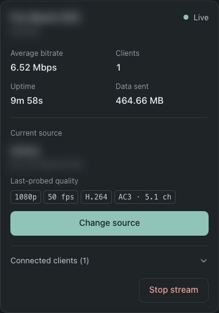
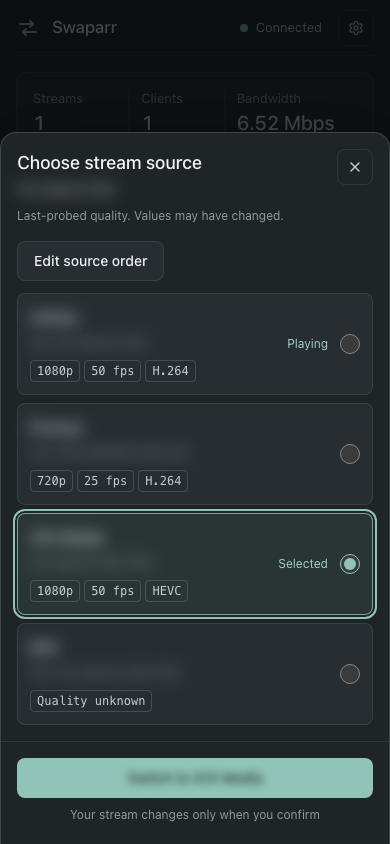
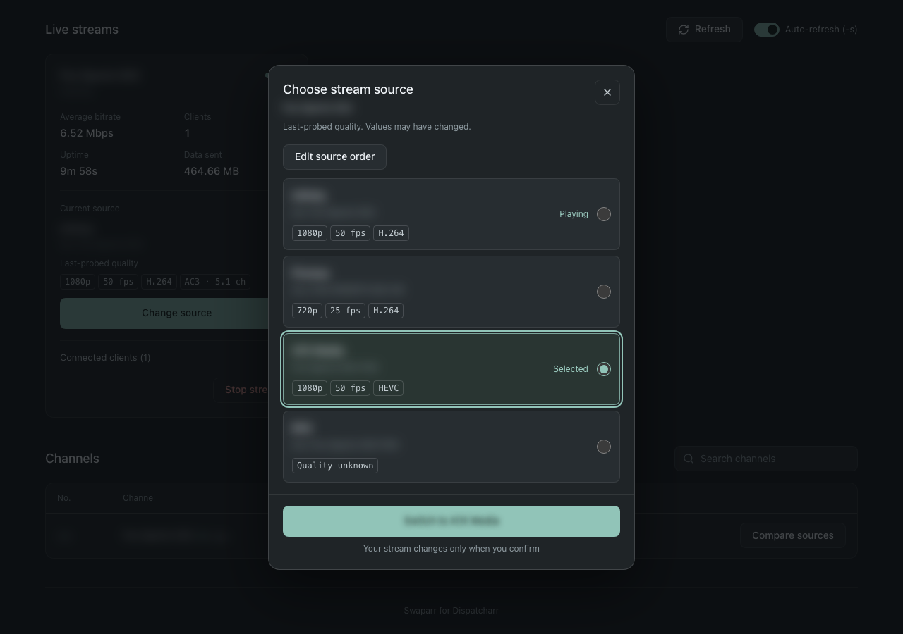
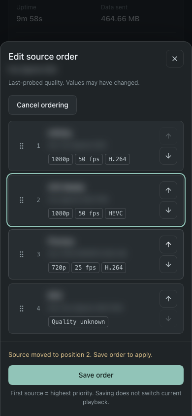

<div align="center">
  
  <h1>🔄 Swaparr</h1>
  <p><b>Dispatcharr Stream Override Tool</b></p>
</div>

<div align="center">

[](https://github.com/mckenna654/swaparr/actions)
[](https://github.com/mckenna654/swaparr/commits/main)
[](https://github.com/mckenna654/swaparr/pkgs/container/swaparr)

</div>

A lightweight, mobile-responsive web dashboard for **Dispatcharr** (middleware for managing IPTV streams, EPG, and proxy connections).

Swaparr brings stream monitoring and source comparison to smaller touch screens, with a compact charcoal interface and a source picker that separates browsing from switching.

<div align="center">
  
  
  <p><em>Live-stream card and mobile source picker. Screenshots use example data; channel and provider names are blurred.</em></p>
</div>

<div align="center">
  
  <p><em>The same source picker opens as a centered dialog on desktop.</em></p>
</div>

## Features

-   📺 **Active Stream Monitoring**: Displays channels currently being streamed, uptime, bandwidth, data transferred, and active client counts. **Bitrate now** is measured between Swaparr's 5-second readings, so a frozen stream shows **Stalled** within about 15 seconds instead of hiding behind a lifetime average.
-   ✅ **Switches that prove they worked**: After you switch a source, the card says "Checking…" and Swaparr watches the next readings. You get **Playing** once data flows on the new source, or **Not playing yet** after 25 seconds with a button to go back to the previous source.
-   🔁 **Find a working source**: One tap tries the channel's other sources in priority order and stops at the first one that actually plays. Tap again to stop.
-   🕵️ **Changes made elsewhere**: When a channel's source changes without you doing it on this page (Dispatcharr's automatic failover, or another device), the card says so, with the time and the previous source.
-   🔄 **Stream Source Picker**: Compare configured sources in a mobile bottom sheet or desktop dialog. Selecting a source does not change playback until you confirm; the currently playing source stays clearly marked.
-   ↕️ **Saved Source Priority**: Choose **Edit source order**, drag sources or use the move-up/down buttons, then **Save order** to persist the priority in Dispatcharr. Works for offline channels too, without switching current playback. Cancel discards your edits.
-   📊 **Compare Source Quality**: The picker shows each source's last-probed resolution, frame rate, and video codec before you switch. These are saved Dispatcharr probe results, not live measurements; sources without usable stats show "Quality unknown".
-   ⏹️ **Stream Lifecycle Controls**: Stop active streams (terminate and release client slots) directly from your phone.
-   🔍 **Channels Browser**: Opens on *your* channels (playing now, or seen playing on this device in the last 30 days) and loads their sources one at a time. Search covers every channel by name or group. Offline sources can be inspected; switching becomes available during playback.
-   👥 **Client Detail Inspector**: Expand any active channel card to see exactly who (IP, User-Agent, transfer speed) is watching.
-   ⚙️ **Server-Side Configuration**: Securely provide your API key via environment variables so you never have to re-type it on different devices.
-   📱 **Native App Experience**: Full PWA support for Android ("Install App") and iOS ("Add to Home Screen") for a beautiful, fullscreen standalone dashboard.
-   ⏰ **Auto-refresh Engine**: Real-time stats engine with configurable automatic polling.

## Prerequisites

Before running Swaparr, ensure you have:
1.  **Dispatcharr Server URL**: The IP and port where your Dispatcharr backend runs (e.g. `http://192.168.1.100:9191`).
2.  **API Key**: Copy your user API key from **Dispatcharr -> Settings -> Users -> API Key** (you can click *Regenerate API Key* if you do not have one).

## Quick Start

### Option 1: Docker (recommended for Unraid / self-hosting)

Pull and run the published image:

```bash
docker run -d \
  --name swaparr \
  --restart unless-stopped \
  -p 8080:8080 \
  -e DISPATCHARR_URL="http://192.168.1.100:9191" \
  -e DISPATCHARR_API_KEY="your_api_key_here" \
  -e NGINX_PORT="8080" \
  ghcr.io/mckenna654/swaparr:latest
```

*Note: The internal container port defaults to 8080, but can be changed via the `NGINX_PORT` environment variable if you need to run it behind gluetun or another network setup.*

Open **http://your-server-ip:8080** on your phone or browser.

#### Unraid

1. Go to **Docker → Add Container**
2. Set **Repository** to `ghcr.io/mckenna654/swaparr:latest`
3. Add a port mapping: `8080` (host) → `8080` (container)
4. Click **Add another Path, Port, Variable**:
   - **Config Type**: Variable
   - **Name**: Dispatcharr URL
   - **Key**: `DISPATCHARR_URL`
   - **Value**: `http://<your-dispatcharr-ip>:9191`
5. Click **Add another Path, Port, Variable** again:
   - **Config Type**: Variable
   - **Name**: API Key
   - **Key**: `DISPATCHARR_API_KEY`
   - **Value**: `<your-api-key>`
6. *(Optional)* If you need to change the internal port (e.g. for Gluetun), add another **Variable**:
   - **Key**: `NGINX_PORT`
   - **Value**: `8080`
7. Apply, then open `http://<unraid-ip>:8080`

### Option 2: Python (local development)

1.  **Set Environment Variables**:
    ```bash
    export DISPATCHARR_URL="http://192.168.1.100:9191"
    export DISPATCHARR_API_KEY="your_api_key_here"
    ```

2.  **Start the Server**:
    Run the lightweight Python server script on your host machine:
    ```bash
    python3 run_server.py
    ```

2.  **Connect from Mobile**:
    The console will print out the network addresses of your computer, for example:
    ```text
    ============================================================
     🔄  SWAPARR - MOBILE OVERRIDE SERVER IS RUNNING
    ============================================================

    Access the dashboard on this computer:
      👉  http://localhost:8080

    Access the dashboard on your MOBILE phone (same WiFi network):
      👉  http://192.168.1.50:8080
    ```
    Open the mobile address on your phone's web browser.

## How Override Works Internally

### Set source priority

Open **Change source** on a live card or **Compare sources** in the channel browser, then choose **Edit source order**. Position 1 is the highest priority. Use the drag handles or arrow buttons to rearrange sources and choose **Save order**. **Cancel ordering** restores the saved order without writing changes.

Saving updates the channel's ordered source list in Dispatcharr; it does not call the live-stream switch endpoint. The picker checks for changes made elsewhere before saving and reads the order back to confirm it. If the list changed, choose **Reload saved order** and arrange it again. This is a pre-save check, not an atomic lock against simultaneous edits.

The Dispatcharr API key must have permission to update channels. Dispatcharr's own automatic channel-sync rules may affect later ordering. Saving priority also works when the channel is offline.

<div align="center">
  
  <p><em>Source ordering. Channel and provider names are blurred.</em></p>
</div>

### API endpoints

The browser never talks to Dispatcharr directly. It calls Swaparr's own proxy, which adds the API key on the server and forwards **only** the calls listed below. Everything else (users, provider accounts, settings and so on) is refused with `403`, so someone who can open Swaparr cannot use it to change the rest of Dispatcharr.

> **`DISABLE_PROXY` has been removed.** It used to send the API key to the browser. Containers that still set it keep working, in proxy mode, and log a warning. If your Swaparr container cannot reach Dispatcharr (for example on a macvlan network), put both containers on a network where they can reach each other.

The forwarded calls:
-   `GET /api/accounts/users/`, `/api/m3u/accounts/`, `/api/channels/groups/`, `/api/channels/channels/` and `/api/channels/channels/<id>/streams/` — read users, providers, groups, channels and each channel's sources.
-   `GET /proxy/ts/status` and `/proxy/ts/status/<channel_uuid>` — live streams and the clients watching them.
-   `POST /proxy/ts/change_stream/<channel_uuid>` — Dynamically re-routes the stream thread to the selected `stream_id` (IPTV playlist link) without interrupting client connections.
-   `DELETE` or `POST /proxy/ts/stop/<channel_uuid>` — Disconnects the clients and stops active streaming buffers to prevent provider ban/over-use.
-   `PATCH /api/channels/channels/<channel_id>/` — Saves the complete ordered `streams` ID list as source priority. Both Docker and Python proxy modes support this operation.

## Styling & Theme

Swaparr uses high-performance, modern native web styling:
-   **Typography**: Native system fonts for clear, fast-loading text.
-   **Theme**: Charcoal surfaces, subtle slate borders, and restrained teal actions.
-   **Responsiveness**: Uses mobile-first layouts that automatically scale up beautifully to tablets and desktop monitors.

## Development checks

GitHub runs every check below on each push (`.github/workflows/tests.yml`).

Run the JavaScript tests with `node --test tests/*.test.cjs`.
Run the Python proxy tests with `python3 -m unittest discover -s tests -v` (uses local loopback servers).
With Docker, run `sh tests/container-check.sh` to build the image and check the proxy allowlist and health check against a fake Dispatcharr.

**Real response shapes.** In Swaparr, open **Server settings → Capture sample data**. It saves one file showing how your Dispatcharr answers, with names, addresses, links and keys replaced by stand-ins. Put it in `tests/fixtures/` and the tests replay it on every push.

**Health check.** The container reports healthy only when its page loads *and* Dispatcharr answers through the proxy, so a wrong URL or API key shows as "unhealthy" in Docker and Unraid.
With Playwright installed, run `node tests/source-picker.browser.cjs` for mocked browser checks of source selection, saved priority, conflict detection, error recovery, mouse/touch dragging, keyboard access, and mobile layouts. The test uses no live Dispatcharr server. Set `CHROME_PATH` to use an installed Chrome executable; `PLAYWRIGHT_MODULE`, `LUCIDE_SCRIPT`, and `SCREENSHOT_DIR` are optional overrides for local tooling and screenshot output. Documentation screenshots automatically blur channel and provider names.

## Docker Image

Published automatically to GitHub Container Registry on every push to `main`:

```
ghcr.io/mckenna654/swaparr:latest
```

Tagged releases are also published when you create a `v*` git tag (e.g. `v1.0.0`).
